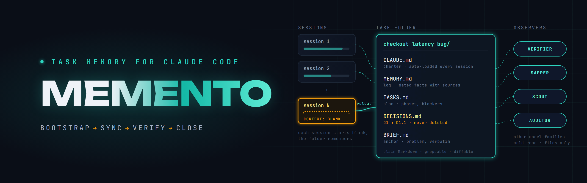
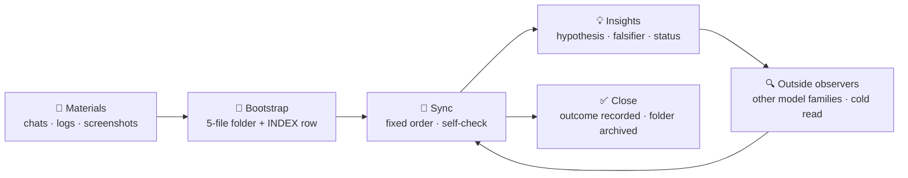

<div align="center">



# 🧠 Memento

### Persistent, file-based task memory for Claude Code. Your agent forgets everything between sessions — Memento doesn't.

**Not "another memory database."** Memento turns every task into a folder of five Markdown files with strict roles, keeps them truthful on its own — and then refuses to trust itself: outside models from other families read the memory cold and check it. No vector store, no MCP server, no service to keep alive.

**Bootstrap → sync → insights → outside observers → close. One command per workspace. Plain Markdown forever.**

[](CHANGELOG.md)
[](https://docs.claude.com/en/docs/claude-code)
[](#️-how-it-works)
[](CONTRIBUTING.md)
[](LICENSE)

[Quick Start](#-quick-start) · [How It Works](#️-how-it-works) · [Features](#-features) · [What makes it different](#-what-makes-it-different) · [Worked example](#-a-worked-example) · [Roadmap](#-roadmap)

</div>

> In the film *Memento*, Leonard can't form long-term memories — so he survives on a ruthless system of notes, photos and tattoos. Your AI agent has the same condition: every session it wakes up blank. This plugin is its system of notes — plain Markdown files, structured so that any future session (or any teammate) can pick up a months-old task in minutes. Developers may also recognize the *Memento pattern*: capturing state so it can be restored later. That is exactly what this is.

---

## 💡 The Problem

LLM agents have brilliant working memory and zero long-term memory. Every new session starts from scratch: the context window fills up, gets compacted, and the *why* behind your decisions evaporates. Chat transcripts are not memory — nobody rereads 400 turns to find out why v3 was rejected.

The result is familiar to anyone doing multi-day, multi-stakeholder work with an agent:

- statuses in your notes drift from reality within a week;
- decision rationale gets lost, and someone confidently rolls back to an option that was already rejected;
- the same fact lives in three files, gets updated in one;
- a task parked for a month takes a full day just to reload into your (and the agent's) head.

That's what Memento fixes.

---

## 🔥 Why it wins

| | Chat history and ad-hoc notes | **Memento** |
|---|---|---|
| **Where the *why* lives** | Buried somewhere in 400 turns | **`DECISIONS.md`** — append-only; a revision is a `D1.1` block, the original stays |
| **Statuses** | Drift from reality within a week | **Synced at natural boundaries** in a fixed order, with a self-check; staleness is measured |
| **The same fact in three files** | Updated in one | **One home per fact** — a litmus test splits stable charter from volatile log |
| **Rejected ideas** | Someone rolls back to them | **Dead-end recall** — stored dead ends are checked before every new decision |
| **Conclusions** | Quoted as facts after a while | **Falsifiable hypotheses** — no falsifier, no decision |
| **Quality control** | The author grades their own work | **Outside observers** from other model families read the memory cold |
| **Reloading a parked task** | A full day | **The charter auto-loads** — Claude Code reads `CLAUDE.md` in the folder for free |
| **Memory actually written** | Hoped for | **Guards** — Stop hooks refuse to end a turn while memory is behind, and every turn snapshots it |
| **Infrastructure** | A database or a service to run | **Plain Markdown** — greppable, diffable, survives uninstalling the plugin |

Storage is table stakes. Not trusting your own memory is the feature.

---

## ⚙️ How It Works

Memento is not a database, not a vector store, not an MCP server. It is a **method plus automation**: a disciplined file layout that turns each task into a self-describing memory unit, and a skill that keeps it truthful automatically. One command initializes the workspace — once; from there the agent creates and maintains the memory itself.



Every non-trivial task gets a folder with five files, each with one strict role:

| File | Role | Changes |
|---|---|---|
| `CLAUDE.md` | **Charter** — scope, environments, stable IDs, stakeholders | Rarely — on scope changes |
| `MEMORY.md` | **Log** — dated facts with sources: who said what when, findings, evidence | Every session |
| `TASKS.md` | **Plan** — phases, checkboxes, blockers | Every session |
| `DECISIONS.md` | **History** — decision records; revisions never delete, only supersede (D1 → D1.1) | On decisions |
| `BRIEF.md` | **Anchor** — the original problem statement, verbatim, plus definition of done | Almost never |

Two details do most of the work:

1. **The charter is named `CLAUDE.md` on purpose.** Claude Code auto-loads it whenever the agent works inside the folder — your task context enters the model for free, every session, no retrieval pipeline needed.
2. **The stable/volatile split has a litmus test.** *"Can I delete this fact in a week without losing meaning?"* → it's log material (`MEMORY.md`). *"Is it valid until the scope changes?"* → it's charter material (`CLAUDE.md`). No more updating the same fact in two places.

A workspace-level `INDEX.md` registers every task folder, so "what's active and where does it live" is one file away. It is a *derived* registry, rebuildable from the folders themselves — which is why a row that disagrees with its task is a repair the structure check performs, not an incident.

Alongside task memory there is a second, **cross-task layer**: session auto-memory — atomic files (one fact each, with frontmatter) holding rules of engagement, stable references and who the user is. Task folders answer *"what is this task?"*; auto-memory answers *"how do we work together?"*.

<details>
<summary><b>📁 Workspace structure</b></summary>

```
workspace/
├── INDEX.md                 # registry of all task folders: active / completed / timeline
├── OPS_LOG.md               # black box: every automatic operation opens a line before writing
├── CHECKPOINT.yml           # the last long operation: its steps, and whether it is still active
├── Insights/                # one insight per dated file: 2026-07-26-deploy-window-freeze.md
├── Observers/               # outside-observer reports + CONFIG.md (model list; key via env var)
├── Consilium/               # optional CONFIG.md: the domain lenses for this workspace
├── task-one/
│   ├── CLAUDE.md            # charter    - scope, environments, stable IDs, stakeholders
│   ├── MEMORY.md            # log        - dated facts with sources, findings, evidence, open questions
│   ├── TASKS.md             # plan       - phases, checkboxes, blockers
│   ├── DECISIONS.md         # history    - decision records D1, D2... revisions as D1.1, never deleted
│   ├── BRIEF.md             # anchor     - original problem statement, verbatim, + definition of done
│   └── ...                  # raw materials (chat exports, logs, screenshots) stay untouched
└── task-two/
    └── ...

session auto-memory/         # cross-task layer (one fact per file)
├── MEMORY.md                # index: grouped rows with a why-it-matters clause
├── feedback_*.md            # corrections and standing preferences from the user
├── project_*.md             # active work: goal, state, next step
├── reference_*.md           # stable lookups: credentials location, contracts, recipes
└── user_*.md                # who the person is
```

</details>

<details>
<summary><b>🧭 Why it works — the design rules</b></summary>

- **Decisions are append-only.** When a decision is revised, the old block stays and a `D1.1` block explains what changed, why, and what happens to artifacts built under the old decision. A month later you can reconstruct the whole path — and nobody re-litigates a settled question.
- **Every fact has a date and a source.** "The API returns 403" is a trap; "the API returned 403 on 2026-06-12, per Jane's message in #backend" is memory. Staleness becomes measurable — the status overview literally measures it.
- **Evidence is triaged explicitly.** During init, every screenshot and log gets an explicit keep/mention/skip decision, and even skipped files are listed — nothing silently disappears.
- **Memory stays bounded.** An append-only log eventually grows too big to load — which defeats the point. Compaction seals the oldest entries into a compressed, still-readable summary (keeping what's load-bearing, dropping resolved noise), so the log stays loadable without losing the thread.
- **Wrong history is refracted, not rewritten.** When past entries turn out to be factually wrong, you add a correction lens at the top of the log instead of editing dozens of scattered lines. What you believed — and when — stays auditable, while every future read is corrected automatically.
- **Cross-task memory has a shape.** Rules of engagement, stable references and who the user is live in session auto-memory as atomic files with frontmatter — one fact per file, indexed — so they accrete for months without becoming an unreadable blob.
- **It's just Markdown.** Greppable, diffable, works in any editor, survives any tooling change. Your memory is not held hostage by a plugin — uninstall Memento and every file remains fully usable. One caveat worth knowing: that applies to *storage*, not to reading. The correction lenses and the phase block sit at the top of a log for a reason, and a human who scrolls straight to the newest entry reads a corrected file uncorrected.

</details>

---

## ✨ Features

| | Feature | How it works |
|---|---|---|
| 🧱 | **Bootstrap** | A task crosses the threshold (more than a day / 2+ stakeholders / release artifact / 2+ phases) → the agent creates the 5-file folder itself, reads every material including images, invents nothing |
| 🔄 | **Sync** | Drift triggers are watched all session; memory is written in a fixed order (lenses → log → insights → decisions → charter → plan → index → auto-memory) and self-checked against the schema |
| 💡 | **Insights** | Contradictions are caught on append; heavier synthesis waits for critical mass. One dated file per insight, with sources and a status |
| 🔍 | **Outside observers** | Other model families read the memory cold under four mandates — verifier, **Sapper**, pattern scout, auditor. High-stakes claims get a **panel vote** |
| 🎯 | **Falsifiable hypotheses** | Every conclusion carries a `falsifier` and `depends_on`; one without a falsifier is an interpretation and never carries a decision |
| 🚧 | **Dead-end recall** | Refuted insights and won't-do items are checked before any new decision or plan is recorded |
| 🗜 | **Compaction** | A log over ~250 lines / ~12 KB has its oldest entries sealed into a compressed summary |
| 🧩 | **Consilium** | A change touching 3+ areas is split across parallel read-only lenses plus a **mandatory skeptic**; disagreements are reported, not averaged |
| 📊 | **Status & health score** | Read-only overview with staleness detection, plus a 0-10 memory health score from every observer report |
| 🩺 | **Structure check** | A no-cost doctor pass: dangling pointers, missing files, stale checkpoints, unregistered folders, unclosed operations |
| 📓 | **Operations log** | Every write opens a line in `OPS_LOG.md` *before* touching a file — a session that dies mid-sync leaves evidence |
| ⏸ | **Checkpoints** | Long operations write `CHECKPOINT.yml` before step one; the next session says exactly where it stopped |
| ✅ | **Closing** | The close is proposed, confirmed, recorded; the index row moves to Completed. Folders are never deleted |
| 🔒 | **Guards** | Stop hooks refuse to end a turn while memory is behind: an operation left open in `OPS_LOG.md`, a decision 45+ min ahead of its log, a promise to write with no file changed |
| 💾 | **Backup ring** | Every turn that changed memory snapshots it into `.memento/backups/` — the newest 20 are kept |
| 🧊 | **Cold-start check** | `/memento:check` — a fresh session answers from context first, then compares with the files; catches memory that never loads, including a moved workspace |

<details>
<summary><b>🤖 Automatic maintenance, in full</b></summary>

An auto-activating **skill** teaches the agent the method itself — the threshold rule (not every task deserves a folder), the file roles, the decision-revision format, correction lenses (refract wrong history, never rewrite it), status glyphs, the shape of session auto-memory — and makes maintenance the agent's duty, not yours:

- **Bootstrap.** When a task crosses the folder threshold (more than a day / two or more stakeholders / release artifact / two or more phases), the agent announces it and creates the 5-file folder itself: reads **everything** in the materials including images, extracts dated stakeholder quotes and evidence, never invents facts — gaps become open questions — and registers the folder in the index in the same operation.
- **Sync.** The agent watches for drift triggers during the session (a decision made or revised, a stakeholder statement, an artifact changed, a phase moved, new evidence, a standing preference, a belief proven wrong) and, at a natural boundary, writes the memory files **in a fixed order** (lenses → log → insights → decisions → charter → plan → index → auto-memory), then checks its own output against the schema and the workspace structure, announcing a diff-style summary of what was written. Nothing fired — nothing touched.
- **Insights.** New entries are checked against everything already recorded — this task's log and decisions, the other active tasks, cross-task auto-memory — in two tiers. Direct matches (a contradiction, an answer to a recorded open question) are caught the moment an entry is appended. The heavier synthesis — repeated failures becoming generalized rules, combinations that change the plan (a deadline collision, an invalidated approach, a merge risk between tasks) — runs only once enough new material has accumulated, because connections need critical mass: forcing the search on every new fact produces noise, not insight. Each finding is saved as a **dated file in the workspace-level `Insights/` folder** (one insight per file, with sources and status: hypothesis / confirmed / refuted), and every involved task's log gets a pointer line — a cross-task insight is stored once and found from all ends. Hypotheses until verified, never silently promoted to fact; refuted insights stay — a documented dead end is also memory. Zero insights is a valid outcome.
- **Observers.** The author never grades their own work: independent models (the model id decides the route — a plain id goes to the provider's own API, an id with a slash goes through OpenRouter; keys via env vars, models via `Observers/CONFIG.md`) are connected automatically when 3+ unverified insights accumulate, before a release handoff, or at a task close. They read the memory **cold** — files only, no session context — which doubles as a live test of memory quality, and report under four mandates: insight verifier, **Sapper** (finds mines under decisions: outdated or unproven assumptions), pattern scout, memory auditor. Reports are saved verbatim and never deleted; a hypothesis can only be promoted by a real-world fact or an observer's verdict; disagreements are recorded, not discarded. Verification is **graduated by stakes**: ordinary claims get one verdict; a claim that touches a release artifact, contradicts a stakeholder, or would revise a decision gets a **panel vote** — every pool model, each through a different lens (sources / alternative explanation / consequences), majority decides, dissent named.
- **Compaction.** When a log crosses its size budget (~250 lines / ~12 KB), the oldest entries are sealed into a compressed summary block that keeps still-relevant facts and drops resolved noise — the log stays loadable without losing the thread. Large seals get a heads-up first.
- **Closing.** When a task is done, the agent proposes the close (confirmation required — closing is semantic), records the final outcome and decision, and moves the index row to Completed. Folders are never deleted — closed tasks are your long-term archive.
- **Status.** Ask "how are my tasks doing?" and get a read-only overview with staleness detection — which memories haven't been synced in a week, where the index contradicts the task's own files — plus each task's **memory health score**: every observer report grades whether a cold reader could reconstruct the task from the files alone (0-10), and the close procedure requires a repair pass before archiving a task whose score is low.
- **Dead-end recall.** Refuted insights and won't-do items are not just kept — they are *consulted*: before any new decision or plan is recorded, the agent checks the stored dead ends and states either "no known dead ends touch this" or which ones do. The accidental rollback to a rejected option is the failure this whole method exists to prevent.
- **Falsifiable hypotheses.** Every recorded conclusion carries two extra fields: `falsifier` — the recognizable fact that would kill it (a log line, a field value, a run result, a stakeholder sentence) — and `depends_on`, the facts it stands on. When a new fact lands, it is checked against the `depends_on` of live hypotheses and their statuses are updated immediately, so memory reacts instead of accumulating. A conclusion for which no falsifier can be named is not a hypothesis but an **interpretation**: labelled as such, and never allowed to carry a decision. The failure this prevents is silent promotion — an unfalsifiable reading that sits in memory long enough starts being quoted as a finding.
- **Consilium.** When a change touches three or more areas at once — crosses languages or services, alters a contract someone depends on, or is a regression that appeared after a fix — a second skill fires on its own and splits the question across parallel read-only agents, each with its own lens and required reading, plus a **mandatory skeptic** whose job is to find the prior rejection. Disagreements between lenses are reported as disagreements, never averaged: two domains contradicting each other marks the zone of real uncertainty, which is the most useful thing the exercise produces. Observers verify what is already written; a consilium looks at what would break before it is written.
- **Structure check.** A no-cost doctor pass that judges nothing and only verifies the structure holds: insight pointers that lead nowhere, registered tasks missing one of the five files, a checkpoint left `active` past a week, folders on disk that no index row mentions, and operations in the log that were opened and never closed. Runs at the end of a multi-file sync and before every close; a clean pass prints one dated line, because "ran it, all clean" and "never ran it" must not look identical. None of these break anything today — they surface on the day someone needs exactly that file, which is usually the handover.
- **An operations log.** Every operation that *writes* opens a line in `OPS_LOG.md` *before* it touches a file, and closes it with the result afterwards — read-only passes stay out of it. The ordering is asymmetric on purpose: a session that dies mid-sync leaves an unterminated line naming the operation and the files it had reached, so the next session starts by repairing exactly those. Forgetting to close a line raises a false alarm someone notices; writing nothing until the end leaves a silent half-finished workspace nobody does. It is not atomicity — plain files cannot offer that — it is evidence instead of a promise.
- **Checkpoints.** Operations too long for one turn (a bulk edit across locales, an eval run, a data load, a release package) get a `CHECKPOINT.yml` written before the first step and updated after each one. If a session starts with an active checkpoint, the agent says which operation stopped where before doing anything else. Context runs out, tools time out, machines reboot — the next session should not have to guess whether step 4 of 9 finished.
- **Guards.** Everything above is a duty the model must remember; guards are the part that does not depend on remembering. Stop hooks (`hooks/guards.js`, plain Node) run at the end of every turn and refuse to let it end while memory is visibly behind: an operation opened in `OPS_LOG.md` and never closed, a decision more than 45 minutes ahead of its log, a final reply that promises a memory write while no memory file changed. Each block names the file and the gap; the agent does the write, or says in one line why the guard is wrong — a guard never blocks twice in a row. Every turn that changed memory also snapshots it into a 20-deep backup ring. Guards fail open: no Node or a script error, and the turn ends normally. One `guards: off` line in `INDEX.md` turns them off.
- **Moving a workspace.** Claude Code keys auto-memory by the project path, so a moved or renamed workspace silently starts without its cross-task layer. A session-start hook warns when the evidence exists — no auto-memory here, a same-named folder elsewhere that has one — and the skill moves it before anything new is written. `/memento:check` then proves, from a cold session, that the memory actually loads.

</details>

---

## 🚀 Quick Start

Two commands in Claude Code, then one per workspace.

```
/plugin marketplace add AndreySukhanov/memento
/plugin install memento@memento
```

| Command | What it does |
|---|---|
| `/memento:init <workspace>` | **One-time workspace initialization.** Creates the `INDEX.md` registry and registers existing task folders (bootstrapping the 5-file set for those that only have raw materials). Pointed at a task folder inside an initialized workspace, it bootstraps just that folder — a manual escape hatch you rarely need. |
| `/memento:check` | **Cold-start check.** Run as the first message of a fresh session after init or a move: the agent answers from context first — instructions, auto-memory, the active task's next step — then compares with the files and runs the guards self-test. |
| `/memento:observers <question>` | **Ad-hoc multi-model panel.** Runs any question (plus attached materials) through the outside-observer pool and synthesizes consensus, disagreements and unique findings. For anything where a second model family's view is worth the tokens: draft reviews, contested decisions, "what am I missing?". |

You run init once per workspace; observers — whenever a question deserves a panel. All *maintenance* — including creating folders for new tasks — is the agent's duty rather than yours, and needs no commands. It is not unconditional: a sync you decline is reverted and recorded as declined, an observer pass with no key or no budget left is skipped with a note, and a session that only answered questions writes nothing at all. Automatic means nobody has to remember it, not that it happens regardless of circumstances.

The guards run on Node.js: with `node` on your `PATH` they work out of the box; without it they stay off, and `/memento:check` says so.

---

## 🛡 What makes it different

File-based agent memory is a crowded category in 2026: markdown-first memory runtimes, tiered session logs, SQLite observation stores, `AGENTS.md` as a standard. Some of them even *reflect* — synthesize conclusions from accumulated facts. **Storing facts is solved. Trusting them is not.**

The difference is what happens **after** the memory writes something down. Reflective memory has one known killer — **self-reinforcing error**: the agent derives a conclusion, stores it, later retrieves it as if it were a fact, and builds the next conclusion on top. Industry reviews call the quality gates for this "still underdeveloped". Memento closes that loop structurally, not with good intentions:

- **The author never grades their own work.** A hypothesis cannot be promoted by the agent that wrote it — only by a real-world fact or an outside observer's verdict.
- **Outside observers are different model families, reading cold.** Independent models get the files and nothing else — no session context, no summaries. Their errors are uncorrelated with the author's, and the cold read doubles as a standing test that the memory actually speaks for itself.
- **Decisions get mined for rot.** The Sapper mandate re-examines what recorded decisions *rest on* — assumptions that were never proven, or that newer facts have quietly contradicted.
- **Verification leaves a trail.** Observer reports are stored verbatim and never deleted; disagreements are recorded with both positions, not resolved by silence.

**Every conclusion in Memento has to survive someone who didn't write it.**

---

## 🧩 Core and layers

Most methods die the same way: all-or-nothing under pressure, then nothing at all. **Memento is built to survive a busy month.** Seven rules are the **core** — the threshold, the stable/volatile split, append-only decisions, the sync, compaction, correction lenses, glyphs — together with four operations: session start, sync, structure check, closing. They pay off on any task long enough to deserve a folder.

Everything else is a **layer** you switch on when it earns its cost: cross-task auto-memory when preferences recur, insight synthesis when conclusions are the deliverable, outside observers when a wrong decision is expensive, checkpoints for operations that span turns, the consilium for changes crossing three or more areas. A workspace that wants only the core says so with one line — `mode: core` in `INDEX.md` — and the layers then run only when asked for by name.

That design came straight from the strongest objection an outside evaluation raised: the real risk is not a bug, it is a busy month. An all-or-nothing protocol does not get trimmed under pressure — it gets dropped, and the memory dies whole. **The core is small enough to keep running with no enthusiasm behind it.**

---

## 🧪 A worked example

**Don't take the spec's word for it — open a task six weeks in.** [`examples/`](examples/) holds one task six weeks in — a revised decision that did not delete its original, two correction lenses, a refuted insight that later stopped someone re-proposing it, a sealed block, and an operations log with a session death and its recovery in the middle. Every other file here is a specification; that folder is what the specification looks like once it has been used. Start with [`examples/checkout-latency-bug`](examples/checkout-latency-bug) if the rules read as abstract.

---

## 🌱 Origin

**Born in production, not in a demo.** Extracted from months of daily prompt-engineering work on a production AI product: dozens of parallel tasks, four-plus stakeholders, decisions revised weekly. Every rule exists because its absence caused a real, remembered failure — drifted statuses, lost rationale, an accidental rollback to a rejected design. What you install is what survived.

<details>
<summary><b>❓ FAQ</b></summary>

**Does it need Claude Code specifically?**
The `/memento:init` command, the auto-activating skill and the auto-loading of `CLAUDE.md` are Claude Code features. The method — five files, litmus test, append-only decisions, sync order — works with any agent or with no agent at all.

**How is this different from a TODO app or a wiki?**
Task trackers store *state*, wikis store *documents*. Memento stores *working memory*: dated facts, superseded decisions with rationale, and evidence — the things you need to resume thinking, not just to report progress.

**Can I move or rename a workspace?**
Yes — task folders travel with it, but Claude Code keeps auto-memory under a folder named after the old path. The session-start guard notices when a same-named folder elsewhere holds it, and the skill moves it before anything new is written; `/memento:check` confirms the result.

**What about vector databases / RAG memory?**
Complementary, not competing. For a single workspace of tasks, structured files beat embeddings on precision, auditability, and zero infrastructure. If you outgrow it, the files are perfect RAG source material — see [`docs/RETRIEVAL.md`](docs/RETRIEVAL.md).

*Low-tech* describes the storage, not the discipline. There is no database to run and no service to keep alive — but there is a protocol: a sync order, checks that must report themselves, formats with required fields. That discipline is exactly what keeps the memory honest, and the [core and layers](#-core-and-layers) split keeps it light enough to run on a bad week.

</details>

<details>
<summary><b>📚 Docs</b></summary>

| File | What's in it |
|---|---|
| [`docs/SCHEMA.md`](docs/SCHEMA.md) | Every required shape in one place — insight frontmatter and the legal status vocabulary, decision blocks, correction lenses, the checkpoint YAML, auto-memory frontmatter, index rows, report formats. The sync's self-check reads this file. |
| [`docs/RATIONALE.md`](docs/RATIONALE.md) | Why each rule is what it is, and the failure it came from. Read it when a rule looks arbitrary or you are about to relax one. |
| [`docs/RETRIEVAL.md`](docs/RETRIEVAL.md) | The interop contract for external search runtimes: markdown is truth, your index is a derived cache. |
| [`examples/`](examples/) | A filled-in task folder after a dozen sessions, with a guide to what to look at and why. |
| [`CHANGELOG.md`](CHANGELOG.md) | Latest: **v2.13.0** — guards that refuse to end a turn while memory is behind, a backup ring, `/memento:check`, and a workspace that survives a move. |

</details>

---

## 🗺 Roadmap

See [BACKLOG.md](BACKLOG.md) — what is still open (verified skill distillation, shared-workspace governance, profile portability), the reasoning behind what shipped, the verdicts on what was rejected, and, just as deliberately, what Memento will **not** do.

Vote with 👍 on [issues](https://github.com/AndreySukhanov/memento/issues), or open a new one.

---

## 🤝 Contributing

The method grows from real failures, so the most valuable contributions are small and grounded:

- A worked example from your own domain — an anonymized task folder after real use
- An integration with a search runtime that holds the [retrieval interop contract](docs/RETRIEVAL.md)
- A rule that contradicts another, or reads two ways — with the failure it causes

See [CONTRIBUTING.md](CONTRIBUTING.md). Open an issue first for bigger changes — happy to discuss the method.

---

## ⭐ Support the project

If this project saved you time or showed you something new — **star it**. It genuinely helps others discover it.

### 💜 Sponsor development

This is a self-funded project — every outside-observer pass and panel vote behind the method runs on paid model APIs. A donation goes straight into model credits for more observer families and more worked examples.

<table>
<tr>
<td valign="top">

**USDT — TRC-20 (Tron network)**

```
TERj89Gjf4qsMW7xyKQWGWtNmBQaDUPnnH
```

> ⚠️ Send **only USDT via the TRC-20 (Tron)** network to this address. Funds sent through any other network will be lost.

</td>
<td valign="top">

</td>
</tr>
</table>

Thank you — even a small contribution keeps the observers reading. 🙏

---

## 📄 License

**Source-Available** — free to read, run and learn from. Commercial or derivative use requires written permission. See [LICENSE](LICENSE).

Licensing contact: [avsukhanov21@gmail.com](mailto:avsukhanov21@gmail.com)

---

<div align="center">

**Built with 📝 Markdown + 🧠 Claude Code skills + 🔍 multi-model observers**

[GitHub](https://github.com/AndreySukhanov) · [LinkedIn](https://www.linkedin.com/in/andrei-sukhanov-2605821b9) · [Email](mailto:avsukhanov21@gmail.com)

</div>
